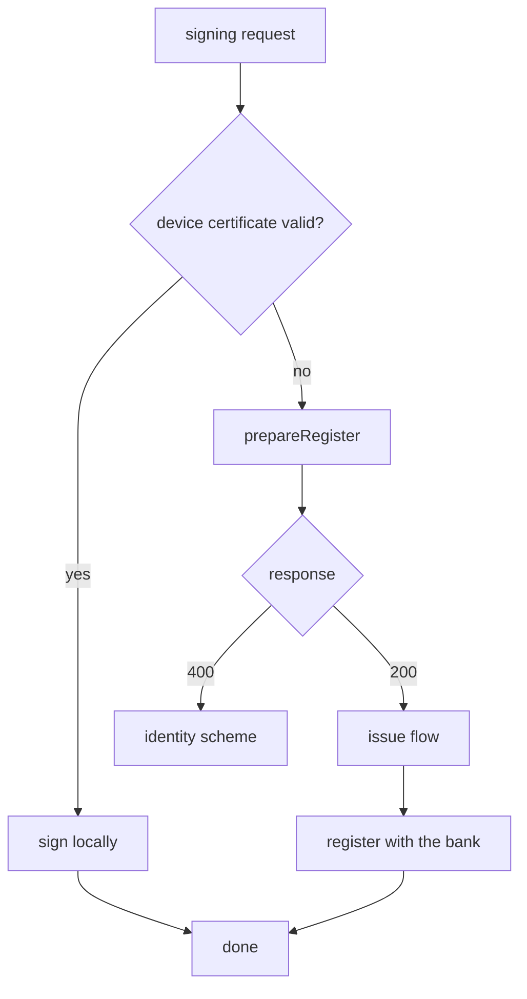
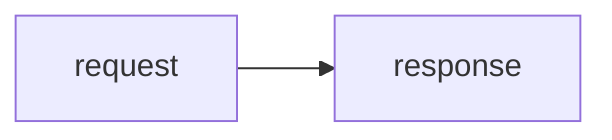
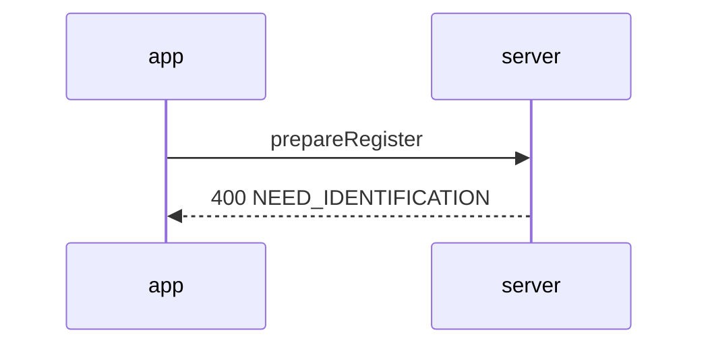

# analysis-doc components

This document uses every component the shell supports, once each. Copy from here to start a new analysis.

A diagram can take a name after the fence. That name is the caption, the name in the canvas list, and the address its layout is stored under. Name the diagrams you intend to work on in the canvas.

## Callouts

:::note what this rests on
The server code is the truth. A comment on the client is not.
:::

:::ok confirmed
`prepareRegister` branches on `level` and nothing else.
:::

:::warn careful
With `identifyList` at `nil`, the `requiresRenew` check is skipped entirely.
:::

:::danger defect
The 200 response is thrown away with `_ =` and the function simply ends. It returns without doing anything.
:::

## Steps

Everything inside a container uses the same syntax as the body. The mermaid block in item 2 below is drawn as a diagram and reaches the canvas list.

:::steps
1. **call prepareRegister** with `level: .lv2`

2. **branch on the response**: 200 issues, 400 goes to the scheme

   ```mermaid
   graph LR
     Q{response} -->|200| I[issue]
     Q -->|400| S[open scheme]
   ```

3. **sign** with `sign(authMethod:type:document:)`
4. **register** with `register(clientID:signedDocument:identifyToken:userNo:)`
:::

## Two columns

:::compare web | native
Treats success as the main path and handles `moveScheme` as the exception.

```ts
const { data } = await prepareRegister({ level: 'LEVEL2', identifyList })
```
---
Treats errors as the main path, and half of the success path is missing entirely.

```swift
_ = try await prepareRegisterCertificate(level: .lv2, identifyList: nil)
```
:::

## Diagrams

A named diagram. It gets a caption, and its layout can be changed on the canvas.



An unnamed diagram. No caption, only the toolbar, and read only on the canvas.



A diagram on a different axis is drawn in the body only. The canvas reads nodes and edges.



## Call trace

```trace
title: the signing entry path
- app | `sign(request:)` | TossBankCertificateService:44
- app | `attemptSign(...)` returns nil | every certificate type failed
? app | `attemptRestoreOrIssue()` | branches on whether restore is possible
- server | `POST /api/certificate/toss/prepare/register` | level=LEVEL2
! server | 400 `NEED_IDENTIFICATION_RESULT` | errorData.moveScheme
+ app | opens the scheme | URLSchemeRouter
```

## Screen

A region marked `[planned]` is one the app does not have yet. Point at a region, a badge or a card and the other two light up.

```screen order detail
frame: phone
- navigation
  ui: nav(back, "주문 상세", share, more)
  note: whether the order can be shared · `order.shareable`
- top notice [planned]
  ui: notice("배송 지연", "10월 23일에 도착해요.", action: "자세히")
  note: the state on this order the user has to check · `order.alerts`
- amount paid
  ui: card
    text("주문번호 2026-1022-0001", s, sub) | icon(copy, s, faint)
    text("48,000원", xl, bold)
    text("포인트 2,000원 사용", s, sub)
  note: amount paid · `payment.amount`
  note: points used · `payment.pointUsed`
- section break
  ui: divider(thick)
  note: layout only, no information
- items
  ui:
    text("주문 상품 2개", m, bold)
    item(gift, "무선 이어폰 케이스", "블랙 · 1개", "32,000원")
    item(card, "보조 배터리", "화이트 · 1개", "16,000원", chevron)
  note: the ordered items · `order.items[]`
- actions
  ui: button("배송 조회", gray) | button("문의하기")
  note: whether the delivery can be tracked · `order.trackable`
```

## Components

```cards what a notice can be
- one line notice
  note: a short notice over the screen
  ui: notice("10월 23일에 도착해요.", action: "자세히")
  field: text | String | the notice
  field: link | URL? | where a tap goes
- failure notice [planned]
  note: something the user has to act on
  ui: notice("결제 실패", "카드 한도를 확인해주세요.", danger)
  field: kicker | String | the state
  field: text | String | what to do
- cancel sheet
  note: asks before cancelling the order
  ui: sheet
    text("주문을 취소할까요?", l, bold)
    text("결제한 48,000원은 3일 안에 돌려드려요.", sub)
    button("닫기", gray) | button("취소하기", danger)
  field: refundAmount | Int | the amount returned
- account row
  note: a list row with a brand mark and a toggle
  ui:
    tabs("전체", "입금", "출금", on: "입금")
    chip("1개월", on) | chip("3개월") | chip("6개월")
    item(토, "토스뱅크 통장", "1000-1234-5678", toggle, on)
  field: alias | String? | the name the user gave the account
```

## Tables

| item | web | native |
|---|---|---|
| main path | 200 | 400 |
| identifyList | always sent | `nil` |
| what follows | unifiedLaunchV2 | nothing |

## Canvas only graph

mermaid node shape notation is taken as it is, and drawn as the same shape on the canvas.

```canvas issue and register path
graph LR
  S[server] --> V([verify])
  V --> T{{issue identifyToken}}
  T --> D[(certificate DB)]
  D --> C{valid}
  C -->|yes| R[[register]]
  C -->|no| X(((end)))
  R --> P[/response/]
  P --> E((done))
```
