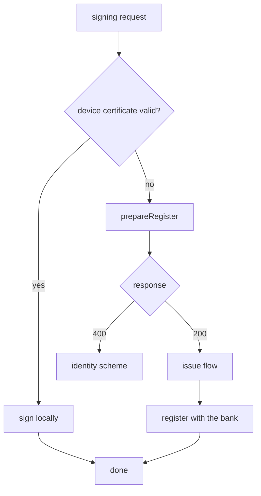
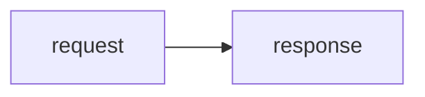
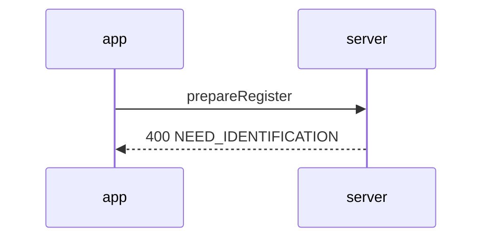

# analysis-doc components

This document uses every component the shell supports, once each. Copy from here to start a new analysis.

A diagram can take a name after the fence. That name is the caption, the name in the canvas list, and the address its layout is stored under. Name the diagrams you intend to work on in the canvas.

## Callouts

:::note what this rests on
The server code is the truth. A comment on the client is not.
:::

:::ok confirmed
`prepareRegister` branches on `level` and nothing else.
:::

:::warn careful
With `identifyList` at `nil`, the `requiresRenew` check is skipped entirely.
:::

:::danger defect
The 200 response is thrown away with `_ =` and the function simply ends. It returns without doing anything.
:::

## Steps

Everything inside a container uses the same syntax as the body. The mermaid block in item 2 below is drawn as a diagram and reaches the canvas list.

:::steps
1. **call prepareRegister** with `level: .lv2`

2. **branch on the response**: 200 issues, 400 goes to the scheme

   ```mermaid
   graph LR
     Q{response} -->|200| I[issue]
     Q -->|400| S[open scheme]
   ```

3. **sign** with `sign(authMethod:type:document:)`
4. **register** with `register(clientID:signedDocument:identifyToken:userNo:)`
:::

## Two columns

:::compare web | native
Treats success as the main path and handles `moveScheme` as the exception.

```ts
const { data } = await prepareRegister({ level: 'LEVEL2', identifyList })
```
---
Treats errors as the main path, and half of the success path is missing entirely.

```swift
_ = try await prepareRegisterCertificate(level: .lv2, identifyList: nil)
```
:::

## Diagrams

A named diagram. It gets a caption, and its layout can be changed on the canvas.



An unnamed diagram. No caption, only the toolbar, and read only on the canvas.



A diagram on a different axis is drawn in the body only. The canvas reads nodes and edges.



## Call trace

```trace
title: the signing entry path
- app | `sign(request:)` | TossBankCertificateService:44
- app | `attemptSign(...)` returns nil | every certificate type failed
? app | `attemptRestoreOrIssue()` | branches on whether restore is possible
- server | `POST /api/certificate/toss/prepare/register` | level=LEVEL2
! server | 400 `NEED_IDENTIFICATION_RESULT` | errorData.moveScheme
+ app | opens the scheme | URLSchemeRouter
```

## Annotated

A drawing in HTML with notes pointing at its parts. App UI comes from the `ui-*` classes (`open-package catalog` lists them). A note marked `[planned]` is a part the app does not have yet. Point at a part, a badge or a card and the others light up.

```annotated order detail
frame: phone
html:
  <nav class="ui-nav" id="nav"><i class="ui-icon back"></i><b>주문 상세</b><span><i class="ui-icon share"></i><i class="ui-icon more"></i></span></nav>
  <div class="ui-stack">
    <div class="ui-notice" id="alert"><i class="ui-icon info"></i><div><small>배송 지연</small>10월 23일에 도착해요.</div><a>자세히<i class="ui-icon chevron s"></i></a></div>
    <div class="ui-card">
      <div class="ui-row"><span class="ui-text s sub">주문번호 2026-1022-0001</span><i class="ui-icon copy s ui-faint"></i></div>
      <div class="ui-text xl" id="amount">48,000원</div>
      <div class="ui-text s sub" id="points">포인트 2,000원 사용</div>
    </div>
  </div>
  <div class="ui-divider thick"></div>
  <div class="ui-stack" id="items">
    <div class="ui-text m bold">주문 상품 2개</div>
    <div class="ui-item"><span class="ui-lead"><i class="ui-icon gift"></i></span><div class="ui-body"><b>무선 이어폰 케이스</b><small>블랙 · 1개</small></div><div class="ui-end"><b>32,000원</b></div></div>
    <div class="ui-item"><span class="ui-lead"><i class="ui-icon card"></i></span><div class="ui-body"><b>보조 배터리</b><small>화이트 · 1개</small></div><div class="ui-end"><b>16,000원</b></div><i class="ui-icon chevron"></i></div>
  </div>
  <div class="ui-stack ui-bottom"><div class="ui-buttons" id="actions"><button class="ui-button gray">배송 조회</button><button class="ui-button">문의하기</button></div></div>
- navigation
  at: #nav
  note: whether the order can be shared · `order.shareable`
- top notice [planned]
  at: #alert
  note: the state on this order the user has to check · `order.alerts`
- amount paid
  at: #amount
  note: amount paid · `payment.amount`
- points used
  at: #points
  note: `payment.pointUsed`, hidden when 0
- items
  at: #items
  note: the ordered items · `order.items[]`
- actions
  at: #actions
  note: whether the delivery can be tracked · `order.trackable`
```

A drawing is not only UI. This one is a canvas drawn by its own script, and the button changes it. A note can point at a box inside the canvas.

```annotated monthly transfers
frame: none
html:
  <style>.chart { padding: 18px 20px 14px; background: var(--ui-bg) } .chart p { margin: 0 0 10px; color: var(--ui-sub); font-size: 13px }</style>
  <div class="chart">
    <p>송금액 (만원)</p>
    <canvas id="bars" width="420" height="180"></canvas>
    <div class="ui-row"><button class="ui-button small gray" id="next">다음 달</button></div>
  </div>
  <script>
    const g = root.getElementById('bars').getContext('2d');
    const months = [12, 18, 9, 22, 30, 26];
    function paint() {
      g.clearRect(0, 0, 420, 180);
      months.forEach((v, i) => {
        g.fillStyle = i === months.length - 1 ? '#3182f6' : '#c9d6ea';
        g.fillRect(10 + i * 70, 176 - v * 5, 44, v * 5);
      });
    }
    root.getElementById('next').onclick = () => { months.push(5 + Math.round(Math.random() * 25)); months.shift(); paint(); };
    paint();
  </script>
- this month
  at: #bars 350, 0, 64, 180
  note: the latest month · `stats.monthly.last`
- the months before
  at: #bars 0, 0, 340, 180
  note: `stats.monthly[0..4]`
```

## Components

```cards what a notice can be
- one line notice
  note: a short notice over the screen
  html: <div class="ui-stack"><div class="ui-notice"><i class="ui-icon info"></i><div>10월 23일에 도착해요.</div><a>자세히<i class="ui-icon chevron s"></i></a></div></div>
  field: text | String | the notice
  field: link | URL? | where a tap goes
- failure notice [planned]
  note: something the user has to act on
  html: <div class="ui-stack"><div class="ui-notice danger"><i class="ui-icon alert"></i><div><small>결제 실패</small>카드 한도를 확인해주세요.</div></div></div>
  field: kicker | String | the state
  field: reason | `"limit" | "expired"` | why it failed
- cancel sheet
  note: asks before cancelling the order
  html:
    <div class="ui-overlay"><div class="ui-sheet"><div class="ui-stack">
      <div class="ui-text l">주문을 취소할까요?</div>
      <div class="ui-text sub">결제한 48,000원은 3일 안에 돌려드려요.</div>
      <div class="ui-buttons"><button class="ui-button gray">닫기</button><button class="ui-button danger">취소하기</button></div>
    </div></div></div>
  field: refundAmount | Int | the amount returned
- account row
  note: a list row with a brand mark and a toggle
  html: <div class="ui-item"><span class="ui-lead">토</span><div class="ui-body"><b>토스뱅크 통장</b><small>1000-1234-5678</small></div><span class="ui-toggle on"></span></div>
  field: alias | String? | the name the user gave the account
```

## Tables

| item | web | native |
|---|---|---|
| main path | 200 | 400 |
| identifyList | always sent | `nil` |
| what follows | unifiedLaunchV2 | nothing |

## Canvas only graph

mermaid node shape notation is taken as it is, and drawn as the same shape on the canvas.

```canvas issue and register path
graph LR
  S[server] --> V([verify])
  V --> T{{issue identifyToken}}
  T --> D[(certificate DB)]
  D --> C{valid}
  C -->|yes| R[[register]]
  C -->|no| X(((end)))
  R --> P[/response/]
  P --> E((done))
```
